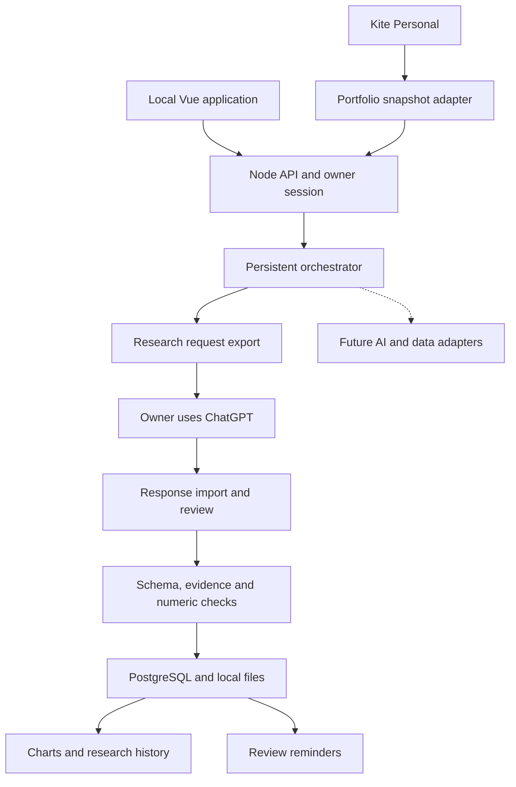

# Trade — architecture and complete execution backlog

Version 2.0 • 18 November 2026 • Planning deliverable

## 0. Release contract for the agreed budget

**Phase A is the current implementation target.** Run privately on Windows with Kite Personal, manual holdings/CSV import, research-request export, manual ChatGPT JSON/text import, evidence review, charts from explicitly supplied data, review reminders and research history. There is no paid API prerequisite for completing the core application. Kite live acceptance still needs the owner's developer credentials and login.

The application orchestrator is ordinary backend code that can run without an LLM. It persists workflow state and invokes deterministic validators/calculators. AI reasoning in Phase A happens when the owner copies the research request into ChatGPT and imports the response. A Markdown skill file provides instructions to an AI tool when loaded; it does not execute itself or supply a model to the application. Runtime agents will become automatic after a supported model adapter is connected in Phase B. Imported confidence is an author's claim and never becomes a calibrated app probability automatically.

**Phase B is the retained future roadmap.** It includes permitted live/historical feeds, automatic news retrieval, runtime LLM agents, tested forecasting models, live price alerts, options selection from fresh chain data and actual-market paper evaluation. Activate after provider access and budget decisions. Phase A completion does not depend on purchasing Phase B services.

Kite Personal portfolio snapshots are dated account observations. The application does not manufacture minute charts, option chains or continuous market alerts from those observations. Permitted CSV price series can support historical charts. Snapshot-based checks occur only on refresh and state that limitation. Missing values remain unavailable. Imported news or research does not change underlying data-use permissions.

| Epic | Phase A delivery | Phase B delivery |
|---|---|---|
| E01 | Windows setup, Node/PostgreSQL, contracts, fixtures | Python model-worker activation |
| E02 | Local owner auth, secrets, ownership, audit | Additional deployment hardening |
| E03 | Searchable approved instrument catalogue, exact contract metadata, source policy | Expanded feed/vendor catalogue |
| E04 | Kite Personal login and reconciliation | Other brokers and paid feed capabilities |
| E05 | Manual/CSV transactions and snapshot valuation | Enriched corporate-action automation |
| E06 | Manual data imports, provenance, synthetic isolated test feed | Live ingestion and licensed history |
| E07 | Manual research evidence and event registry | Automated filing/news ingestion |
| E08 | Portfolio and charts of available imported data | Live chart streaming |
| E09 | Deterministic orchestrator, validation, agent specifications | Model-powered research agents |
| E10 | Imported conditional scenarios with explicit origin | Trained/calibrated equity forecasts |
| E11 | Exact contract research templates and snapshot review | Fresh-chain ranking and option backtests |
| E12 | Limits, deterministic exposure calculations | Automated model recommendation checks |
| E13 | Separate synthetic simulator for development | Permitted actual-market simulation |
| E14 | Research expiry/calendar reminders and snapshot checks | Continuous quote-driven alerts |
| E15 | Copy request, import response, history and predefined queries | Automatic conversational model |
| E16 | Imported-research outcomes when observations exist | Full unbiased model scorecards |
| E17 | Windows startup, backup/restore and local acceptance | Cloud hosting when funded |

For split stories, track Phase A and Phase B acceptance separately. Phase B is Deferred by Scope, not a blocker or a claim of completion. The original acceptance criteria below govern the complete roadmap; the additions and Phase A contract govern the current release.

## 1. Product outcome and implementation assumptions

Build a private application for Indian equities and index options, with portfolio tracking, company exploration, evidence-backed research, probabilistic forecasts, chat, notifications and paper trading. The interface serves both experienced users and beginners through charts, concise summaries and expandable detail. All items below are planned work. Software implementation and live-provider validation have yet to begin.

Proposed defaults are Vue 3 with TypeScript, Node.js with TypeScript, PostgreSQL, with a Python analysis worker added in Phase B. The initial broker is Zerodha using Kite Personal for portfolio access. The current release uses manual ChatGPT research exchange and deterministic application workflows. Paid AI and market-data integrations belong to a later owner-funded stage. Angel One and Upstox follow behind the same connector interface. Initial deployment is a private responsive web app/PWA running on the owner’s Windows computer. Cloud hosting is deferred until the owner chooses to fund it. Initial universe is user holdings, a bounded watchlist, BANKNIFTY and relevant constituent banks. Expand coverage after measuring feed limits and costs. The working product name is Trade. These are reversible design choices for the owner to verify.

The first release provides imported research, review reminders, manual portfolio records and broker portfolio synchronisation. A separate synthetic simulator exercises software correctness. Market-data simulation awaits permitted data access and resolution of the combined-app usage question with Zerodha. Real broker order execution requires a separately specified feature and explicit authorization. Brokerage credentials remain with the broker-hosted login where supported. A token's actual permissions must be inspected, because a portfolio-only UI cannot restrict a broadly privileged token.

Price-target alerts and model suggestions are independent features. Live, delayed, replay and synthetic inputs carry explicit mode labels through charts, chat, forecasts and simulations. Return targets are user objectives. An 80% accuracy target is an evaluation hypothesis whose definition and measured sample must be shown.

## 2. Prerequisites and owner inputs

| Input needed | When needed | Safe way to provide it | Default or work that can continue |
|---|---|---|---|
| Git repository URL or local project folder | Before implementation | Repository access or local path | Prepare this backlog and architecture now |
| Windows machine and project path | Before implementation | Local folder path and installed runtime versions | Private single-owner local development is confirmed |
| Preferred first broker | Before live portfolio integration | Broker name only | Zerodha adapter first |
| Broker developer app and registered redirect URL | Before broker acceptance testing | Configure ignored local backend environment file | Implement callback flow and contract tests with fixtures |
| Live and historical data provider | Before actual market ingestion | Provider documentation, entitlement and permitted-use confirmation | Synthetic adapter and ingestion contracts |
| Paper-trading data rights and applicable-use review | Before market-data paper mode | Written provider terms covering intended simulation use and review of applicable rules | Synthetic simulation remains implementable |
| Expired-options dataset and quote granularity | Before historical options evaluation | Licensed sample and coverage report | Implement replay engine and validate on synthetic cases |
| News/filings provider | Before live research | API subscription and retention/AI processing rights | Evidence schema, ingestion adapter and fixture tests |
| LLM API provider and spending ceiling | Before connected agent tests | Secret manager entry, provider name and monthly limit | Deterministic fixture agent outputs |
| Cloud hosting/domain | Future owner-selected stage | Hosting access when funded | Local launch requires no hosting account or domain |
| Holdings CSV, if desired | Before personal portfolio review | Redacted export with symbols, trades, prices, dates and fees | Manual entry supported |
| Notification preference | Before device acceptance | Web push enabled on chosen device | In-app alerts |
| Virtual opening balance | Before first paper session | User setting | Propose ₹100,000 virtual cash, configurable |
| Capital, loss limits and holding horizon | Before personalised position sizing | In-app settings | General instrument research can proceed |

Never paste broker passwords, PINs, OTP seeds, API secrets or full account identifiers into chat, issues or repository files. ChatGPT/Claude consumer subscriptions should not be assumed to include API billing. Obtain provider pricing when selecting services. This document commits to no paid subscription.

### Data-use correction and activation dependencies

Earlier discussion assumed Kite could feed paper trading. Its published terms explicitly prohibit using the APIs/live data for virtual or mock trading apps. The implementation must honor that restriction. A separate provider is only a candidate solution; its contract and applicable rules must explicitly support the intended use. SEBI has published restrictions concerning real-time data sharing and an advisory about unauthorized public virtual-trading platforms. Personal use is the starting scope, and a public launch requires a fresh review of data licensing and the intended research/advisory service. These checks affect activation of the relevant integrations, while development of schemas, UI, synthetic simulation and tests can continue. Sources [S1–S3].

Kite also lacks historical expired-options data. Three-to-five-year options evaluation therefore depends on a separately verified dataset [S4]. Exact expiry dates, lot sizes and valid strikes come from dated contract records. Historical values must be preserved rather than applying today's specifications to past trades.

## 3. Architecture and responsibilities

Use one repository and a modular Node API with separately running ingestion/job and Python analysis processes. This keeps deployment manageable while giving numerical workloads their own runtime. Each module owns its writes. Shared typed contracts define communication boundaries.

| Component | Proposed choice | Ownership and reason |
|---|---|---|
| Web | Vue 3, TypeScript, Vite, Pinia | Familiar stack; portfolio, charts, chat, settings and PWA |
| API | Node.js LTS, TypeScript, Fastify | Authentication, permission enforcement and business modules |
| Database | PostgreSQL | Transactions, decimal money, temporal records and JSON evidence metadata |
| Jobs/cache | PostgreSQL durable job queue and bounded in-process quote cache | Retry scheduling, leases and restart recovery without an additional server installation |
| Numerical worker | Later Python worker | Phase A calculations use decimal-safe Node code; Phase B adds features, calibration and backtests |
| Artifacts | Private local filesystem directory | Licensed datasets, models, exports and replay files; paths and checksums recorded in PostgreSQL |
| Charts | Financial-chart library selected after license review | Candles, comparisons, event overlays, forecasts and virtual fills |
| Orchestrator and agents | Persistent Node state machine plus versioned agent instructions | Phase A exports requests and validates imports; Phase B invokes model adapters with the same contracts |
| Notifications | Web Push with VAPID plus persistent inbox | Mobile/desktop notifications with auditable delivery attempts |
| Operations | Native Windows processes and PowerShell scripts | API, worker and Python processes start locally; Docker is optional future packaging |

Select supported dependency releases and pin lockfiles when implementation begins. PostgreSQL is a proposed change from the owner's familiar MySQL stack, chosen for these workloads; MySQL remains feasible if the owner prefers it. Start with partitioned candle tables and a bounded universe. Retain high-volume tick history only when licensing and capacity support it. PostgreSQL persists jobs, outbox and financial state. Cache can be rebuilt after restart. Use a supported PostgreSQL queue library or a small reviewed implementation with atomic claims, leases, retry limits and idempotent handlers.

### Local runtime and cost baseline

Cloud hosting budget is ₹0 for the current release. The first-release application runs on the owner's Windows PC using Node.js/npm and PostgreSQL. Python becomes required for the later numerical-analysis stories. Git is required for repository work. Existing installations must be inspected and reused when compatible. PostgreSQL may be the only missing installation if the other tools are already installed; this has not been verified on the owner's computer. Vue and application libraries install through npm, and numerical libraries through a Python virtual environment. Docker, Redis and paid object storage are optional future infrastructure.

Use a bounded watchlist, small ingestion batches and one analysis job at a time initially; measure actual memory and disk usage before increasing concurrency. Start with approximately 10 watched instruments and selected BANKNIFTY contracts, then tune to the measured machine capacity. Large backtests run on demand and pause live analysis if resources are insufficient. Hosted AI, news and market-data services may still have charges. Paid integrations require the owner's budget choice; missing subscriptions leave the relevant capability unavailable while synthetic development continues.

Local addresses are frontend http://localhost:3001, API http://localhost:3000, and Kite callback http://localhost:3000/api/brokers/kite/callback. Register the exact callback in the developer console and complete login on the same PC. Bind API/database to loopback by default. Keep backend secrets outside Git and frontend bundles. Use a dedicated database role for the application rather than the PostgreSQL administrator.

Monitoring operates while the PC is awake, connected to the internet and running the worker. On shutdown/sleep/disconnection, live monitoring pauses. On resume, mark the gap, refresh quotes and broker session, reclaim expired job leases and evaluate current conditions. Never invent missed ticks or backdated live fills. Recover historical gaps only when provider access permits, with clear replay provenance. Desktop notifications and in-app inbox are the local acceptance target. Phone push requires a separately reachable secure origin for subscription setup and an online sender; it is a later optional integration.

PostgreSQL Windows installer: https://www.postgresql.org/download/windows/ . Use a stable supported Windows x86-64 version, server, pgAdmin and command-line tools. Keep the default port 5432 if free. Extra StackBuilder packages are optional. After installation verify connectivity, then create the dedicated role/database through setup scripts.

### Repository boundaries

| Directory | Owns |
|---|---|
| apps/web | Screens, charts, client state and service worker |
| apps/api | HTTP endpoints, auth, portfolio, connectors and server authorization |
| apps/worker | Feed ingestion, orchestrator jobs, alerts and delivery |
| services/analysis | Features, risk calculations, forecasts and backtest engine |
| packages/contracts | Versioned API/event schemas and generated client types |
| packages/provider-adapters | Broker, market-data, news and synthetic interfaces |
| db/migrations | Ordered, reviewed schema migrations |
| tests/fixtures | Clearly synthetic or licensed test data and clock scenarios |
| docs | Architecture decisions, story status, API contracts and runbooks |

## 4. Core records and contracts

Every user-owned record includes owner_id and server-side ownership enforcement. Use UUIDs for internal identifiers. Broker tokens are namespaced mappings, never permanent instrument identities. Monetary values and quantities use decimal-safe representations. Store timestamps in UTC and render Asia/Kolkata by default. Preserve exchange time, publication time, received time and processing time separately.

| Domain | Principal records | Important invariant |
|---|---|---|
| Identity | users, sessions, broker_connections, secret_references | Secrets stay server-side and outside AI context |
| Instruments | instruments, listings, contracts, provider_mappings, calendars | Exact exchange/expiry identity and effective-dated lot sizes |
| Entitlements | data_sources, permitted_uses, retention_policies | Mode and destination checked before data use |
| Portfolio | accounts, trades, cash_entries, corporate_actions, reconciliation_runs | Append corrections and preserve original transactions |
| Market data | quote_events, candles, source_health, dataset_manifests | Provenance, completeness and late-event handling |
| Research | source_documents, evidence_spans, events, company_exposures | Claims reference retrieved source versions |
| Forecasts | research_runs, feature_snapshots, model_versions, forecasts, evaluations | Original prediction and as-of inputs immutable |
| Risk | user_limits, scenario_results, recommendation_checks | Unknown limits cannot silently become unlimited |
| Paper | virtual_accounts, orders, fills, ledger_entries, fee_versions | Cash reservations and fills atomically balanced |
| Notifications | alert_rules, alert_events, outbox, delivery_attempts | One trigger identity, retryable delivery |
| Operations | audit_events, job_runs, dead_letters | Reproducible runs and redacted logs |

### Minimum API surface

| Route group | Required operations |
|---|---|
| /auth, /settings | Session management, preferences, limits and device subscriptions |
| /instruments | Search, exact contract resolution and corporate profile |
| /connections | Connect, callback, sync status and disconnect |
| /portfolios | Accounts, transactions, imports, reconciliation and valuation |
| /market | Quotes, candles, company events and source freshness |
| /research-runs | Submit question/instrument/horizon; retrieve status and validated output |
| /forecasts | Immutable forecast detail, history and evaluation results |
| /paper | Accounts, order preview, create/cancel, fills, positions and performance |
| /alerts | Rules, trigger history, acknowledge, snooze and delivery status |
| /admin/data-health | Provider health, entitlements, model status and job recovery |

Mutating requests accept idempotency keys. Return consistent structured errors including AUTH_REQUIRED, DATA_STALE, SOURCE_UNAVAILABLE, USAGE_NOT_PERMITTED, INSUFFICIENT_EVIDENCE, INSUFFICIENT_CASH and CONFLICT. Do not expose secret values in error payloads.

Event envelope fields include event_id, schema_version, owner_id where applicable, instrument_id, occurred_at, received_at, source_id, mode, correlation_id and payload. Events include QuoteAccepted, CandleClosed, ResearchRequested, ForecastPublished, PaperOrderTriggered, PaperFillCommitted and AlertTriggered. Consumers deduplicate event IDs. Use a database outbox for committed state changes so worker crashes cannot silently lose notifications.

Forecast output includes instrument/contract, as_of, horizon_end, input snapshot ID, model version, forecast type, distribution or validated probability, calibration status, evidence IDs, contradictory evidence, entry condition, invalidation condition and limitations. Uncalibrated scores must be labelled as scores. No invented success percentages.

## 5. Research, forecasting and guardrails

The orchestrator follows resolve instrument → verify entitlement and freshness → collect evidence → calculate features → evaluate candidate scenarios → validate risk and provenance → persist result → render. Each step has bounded tool access, timeout, retries and budget. A stale quote can still support historical explanation when explicitly labelled, but cannot quietly become a current entry recommendation.

Research agents cover market context, company/sector events, options interpretation and explanation. Agents call typed tools and return structured output. Financial calculations and order transitions are deterministic code. Evidence validation checks cited passages and instrument association. A review agent may identify contradictions but does not certify truth solely by agreeing with another model. External articles are untrusted content with no authority over prompts, secrets or tools.

Start numerical work with transparent baselines: unchanged-price forecast, historical return distribution and simple trend/volatility models. Test richer models only against those baselines. Inputs can include returns, volatility, market/sector-relative movement, constituent contributions, liquidity and timestamped event features. No arbitrary fixed weighting such as 'news 40%, technicals 60%' is treated as validated. Company ownership statistics are dated filings; market-wide holder profit counts are unavailable without holder-level cost data.

Define outcomes before training. Directional targets specify the exact horizon and return threshold. Trading targets specify target-first, stop-first, neither and ambiguous paths. Train and evaluate in chronological windows. Purge overlapping target windows at fold boundaries and use a gap appropriate to the horizon. Keep the final test untouched by model selection. Historical news uses first available versions and received-time constraints. Preserve delisted instruments and historical constituents where relevant to avoid survivorship bias.

For options, evaluate actual contracts using historical bid/ask data where available, effective contract specifications, time of day, expiry distance, liquidity, volatility and fees. Underlying direction alone cannot validate an option-return forecast. Greeks are sensitivity estimates with stated pricing assumptions. A recommendation can legitimately be WAIT or INSUFFICIENT_EVIDENCE. Daily profit targets cannot force position size or a trade.

Model lifecycle is draft → research-evaluated → shadow → eligible → suspended/retired. Proposed eligibility criteria are reproducibility, no material data leakage, performance measured after costs against a named baseline, calibration appropriate to any published probabilities and acceptable drawdown under owner-configured limits. Thresholds and minimum sample requirements must be versioned before final evaluation. Passing software tests does not prove a profitable strategy. Failed candidates remain research results with an explicit failure explanation.

## 6. User experience and paper execution semantics

Navigation contains Portfolio, Explore, Paper Trading, Chat, Alerts and Settings. Search is available throughout. The holding form accepts instrument, quantity, purchase price/date and optional comments. Explore shows price/volume, period returns, sector comparison, ownership filing dates, factor cards, evidence and forecast ranges. Chart interval and forecast horizon are separate settings. Every page shows data mode and relevant as-of time.

Paper Trading supports 'Test this trade' from a forecast with quantity/budget and explicit entry/exit conditions. Preserve forecast ID, original parameters and user overrides. Long cash and long CE/PE virtual positions form the initial simulator scope. Multi-leg and uncovered option-selling simulation are future scope needing margin, assignment and strategy semantics.

Virtual market buys use the next eligible ask after order activation; sells use bid, with spread/slippage assumptions and available size constraints. Limit orders require executable quotes and volume/size constraints. Stops activate on a defined quote/last-price policy and fill at the next available executable price. Broker/data terms determine which mode can feed the simulator. With candle-only data, use conservative explicit fill assumptions and mark unknown within-candle ordering ambiguous. A replay clock hides future data from both agents and UI until released.

The ledger reserves cash before fills, supports partial fills, charges versioned fees, updates realised/unrealised P&L, handles cancellations and records expiry settlement. Atomic transactions and idempotency prevent duplicate fills or negative cash under concurrency. Intraday orders carry an exchange-calendar-aware close time; missing close quotes leave a clearly unresolved valuation rather than an invented fill. Account reset creates an archived run and new ledger. Manual exits and model exits are attributed separately.

Alerts include price/return thresholds, trailing thresholds, source events and validated model-state changes. Evaluate simple thresholds on accepted quotes without waiting for an LLM. Use crossing detection, cooldown, hysteresis where configured and rearm policies. Persist inbox entries even when push delivery fails. Push acceptance by a gateway is distinct from user-device receipt. A price gap can cross several thresholds at once; report the first observed executable/current price and combine duplicate notices.

## 7. Full epic backlog

Stories below are ordered within each epic. Each story inherits the completion contract in section 9. Dependencies refer to completed capabilities, allowing unaffected stories to proceed when a provider credential is unavailable. Acceptance statements are minimum checks, including negative paths. All story statuses start as Planned.

### E01 — Foundation and executable development environment

Dependencies: repository access. Outcome: one-command local development and versioned contracts.

- **E01.01 Repository and commands.** Create the directory boundaries above, supported runtime pins, dependency lockfiles and environment example. Acceptance: a clean Windows clone passes a PowerShell prerequisite check, installs dependencies, runs web/API/workers through a documented start command, and starts without real credentials in labelled synthetic mode.
- **E01.02 Database and jobs.** Add migrations, seed instruments and PostgreSQL job configuration. Acceptance: fresh and upgrade migrations work; a repeated job does not duplicate its effect; expired leases recover after worker restart; failed jobs surface with redacted context.
- **E01.03 Contracts and CI.** Define schema validation, generated types, lint, type checks, relevant tests and build pipeline. Acceptance: incompatible schema or invalid API payload fails visibly; CI runs on a clean checkout.
- **E01.04 Configuration and time.** Centralize modes, UTC clock abstraction, exchange timezone, feature capabilities and provider settings. Acceptance: deterministic tests can advance the clock; missing production settings identify the disabled capability without crashing unrelated modules.
- **E01.05 Shared visual foundation.** Add reusable colors, typography, spacing, controls, cards, badges and feedback states. Acceptance: desktop/mobile layouts use readable contrast, keyboard focus, accessible labels and responsive reusable patterns.

### E02 — Identity, privacy and access control

Dependencies: E01. Outcome: private authenticated application.

- **E02.01 Owner authentication.** Implement secure sessions, expiry, logout and protected routes. Acceptance: unauthenticated and expired sessions are rejected by the API; logout invalidates the session.
- **E02.02 Ownership enforcement.** Scope every portfolio, research run, paper account and subscription by owner. Acceptance: attempts to fetch, mutate or subscribe to a second test owner's records fail across HTTP and live streams.
- **E02.03 Secret handling.** Integrate server-side secret references, encrypted token storage, rotation and redaction. Acceptance: secrets do not appear in browser payloads, exports, logs or agent prompts; disconnect makes the stored connection unusable.
- **E02.04 User preferences and privacy.** Add display settings, notification controls, export/deletion and audit history. Acceptance: deletion respects required retention and explains retained records; exported data contains no access tokens.
- **E02.05 Owner setup and login experience.** Detect setup state from the backend and render setup or login with validation, loading, password visibility and duplicate-submit protection. Acceptance: setup is server-restricted, invalid login is explicit, successful setup opens the session and logout returns to login.
- **E02.06 Authenticated application shell.** Provide responsive sidebar/mobile navigation, top bar, data-mode status, page states and working logout. Acceptance: protected pages require a valid session and unavailable features explain dependencies honestly.

### E03 — Instruments, contracts and data entitlements

Dependencies: E01. Outcome: reliable searchable instrument identities.

- **E03.01 Security master.** Import symbol/name/exchange/ISIN listings and provider mappings. Acceptance: Tata Steel search resolves the selected listing; duplicate names and changed symbols are handled; expired mappings cannot silently resolve to new instruments.
- **E03.02 Options master and calendar.** Store underlying, CE/PE, strike, expiry, lot size, tick size and effective dates. Acceptance: ambiguous NOV labels require exact resolution; holidays and historical lot changes replay correctly.
- **E03.03 Source-use policies.** Record permitted personal analytics, simulation, storage, AI processing and redistribution uses. Acceptance: Kite-sourced input is rejected for virtual-trading use under current terms; synthetic mode works; unknown permissions appear unresolved.
- **E03.04 Dataset acceptance report.** Inspect sample schemas, timestamps, coverage, missing intervals and rights. Acceptance: report lists usable instruments/horizons and absent fields; missing expired-options history stays an explicit dependency.

#### E03.05 — Catalogue import without a paid market feed

As the owner, I want searchable companies and exact option contracts from a permitted catalogue so I can select what I own or research.

Dependencies — E01, E03.01–03.

Acceptance — Import a reviewed CSV catalogue with exchange, symbol, name and identity fields. Catalogue source and as-of time are mandatory. Search does not call a paid endpoint. Unknown instruments can be entered as unresolved manual records and must be resolved before broker reconciliation. Option contracts require underlying, strike, CE/PE, exact expiry and dated lot size. A sample catalogue is labelled synthetic and cannot silently become a real listing source.

### E04 — Broker connections and portfolio reconciliation

Dependencies: E02–E03. Outcome: reliable real holdings with optional broker sync.

- **E04.01 Connector contract.** Define connect, callback, holdings, positions, sync and disconnect capabilities. Acceptance: fixture adapters exercise success, rate limiting, expired sessions and unsupported historical trades.
- **E04.02 Zerodha integration.** Implement official hosted login, callback validation, token exchange and holdings/positions retrieval. Acceptance: verified connection through the registered localhost callback imports a snapshot; invalid callback and expired token fail safely; callback token is removed from browser URL after exchange; manual data remains available during outage.
- **E04.03 Reconciliation.** Compare broker snapshots with manual/imported transactions using provenance and account identity. Acceptance: repeat sync is idempotent; missing historical purchase dates are labelled unknown; mismatches require explicit resolution and preserve audit records.
- **E04.04 Additional brokers.** Implement Angel One and Upstox adapters using their current supported login methods and documented scopes. Acceptance: each passes the shared contract suite and live sandbox/personal acceptance when authorized credentials exist; missing access blocks only that connector's live verification.

### E05 — Portfolio transactions and accounting

Dependencies: E02–E03; E04 for sync integration. Outcome: correct actual portfolio valuation.

- **E05.01 Add/edit trades.** Support searchable instrument, quantity, date, price, fees and optional comments. Acceptance: repeat purchases, partial sales and correction entries reconcile; invalid quantities and future actual trade dates fail validation.
- **E05.02 Import preview.** Map CSV broker exports, validate rows, detect duplicates and show review before commit. Acceptance: repeating an import adds no duplicate trades; invalid rows receive actionable reasons; a failed commit rolls back its batch.
- **E05.03 Valuation and returns.** Calculate cost, cash flows, realised/unrealised P&L and period performance with a documented cost-basis policy. Acceptance: multiple purchases/sales reconcile to worked examples; deposits cannot be counted as trading returns; stale prices display their timestamp.
- **E05.04 Corporate actions.** Apply effective-dated splits, bonuses and dividends with adjustment provenance. Acceptance: split quantities and cost basis reconcile; applying the same event twice has no effect; adjusted chart prices never overwrite raw trade prices.

### E06 — Market feeds, historical ingestion and recovery

Dependencies: E03. Outcome: validated market snapshots and reproducible history.

- **E06.01 Provider adapters.** Implement bounded subscriptions, entitlement checks, quotas and reconnect/backoff. Acceptance: synthetic feed works immediately; licensed live adapter recovers without duplicate accepted ticks; revoked entitlement stops the affected stream.
- **E06.02 Quote validation and candles.** Validate prices/timestamps, detect stale/out-of-order input and build interval candles. Acceptance: duplicate and late events follow documented rules; completed candles and incomplete candles remain distinguishable.
- **E06.03 Historical ingestion.** Store immutable dataset manifests, checksums and revision lineage with resumable jobs. Acceptance: interrupted loads resume without duplicate rows; calendar gaps and actual missing data are distinguished; instrument changes retain mappings.
- **E06.04 Health and fallback.** Show source freshness, disconnects and partial coverage. Acceptance: stale data prevents current-action forecasts; historical views remain usable with labels; fallback sources retain their own provenance and entitlements.

#### E06.05 — Manual market observations and historical CSV

As the owner, I want to supply permitted price observations and historical series so I can chart the data I actually have.

Dependencies — E03, E05.

Acceptance — Preview CSV mapping, instrument, time zone, source and data-use permissions. Reject invalid dates, negative prices and malformed candle ranges. Deduplicate imports by source/instrument/timestamp/version with an explicit correction preview. Preserve source time and import time. Sparse observations display as observations without fabricated candles. BANKNIFTY options snapshots identify every exact contract and its quote time. Portfolio snapshots cannot be represented as a full quote feed. A database transaction rolls back a failed batch.

### E07 — Company research, news and event evidence

Dependencies: E03, E06 contracts. Outcome: traceable company and sector factors.

- **E07.01 Filings and profiles.** Ingest company reports, dated shareholder filings and financial metrics with source links. Acceptance: revised filings preserve versions; ownership counts carry as-of dates; missing holder profit data is shown as unavailable.
- **E07.02 News ingestion.** Normalize source URLs, publication/receipt times, deduplicate stories and retain corrections under source rights. Acceptance: repeated syndicated news creates one grouped event; allegations and official findings have distinct statuses.
- **E07.03 Exposure mapping.** Map events to companies/sectors with cited business exposure and conflicting evidence. Acceptance: war/oil/software/banking fixtures show why an instrument is relevant; weak connections return uncertain relevance.
- **E07.04 Upcoming events.** Add results/policy calendars and developing-event updates. Acceptance: scheduled time changes update reminders; unknown outcomes remain unknown; alerts use the last verified event version.

#### E07.05 — Manual evidence register

As the owner, I want to paste news references and source excerpts so research can be reviewed later.

Dependencies — E02, E03.

Acceptance — Capture title, source URL, published time where known, retrieved time, relevant instruments, excerpt and allegation/confirmed-event status. Missing dates are labelled unknown. Duplicate references are grouped without deleting revisions. Store unsupported claims as unverified. Opening a source is user-directed. Automatic URL verification, if implemented, rejects local/private IP destinations and unsafe redirects to prevent server-side request forgery. Links alone do not certify factual support.

### E08 — Explore charts and portfolio UI

Dependencies: E05–E07. Outcome: graph-led research interface.

- **E08.01 Navigation and search.** Implement responsive Portfolio, Explore, Paper, Chat, Alerts and Settings navigation. Acceptance: search and selection work on mobile/desktop; keyboard and accessible labels work; each mode is visibly labelled.
- **E08.02 Price and comparison charts.** Render candles, volume, trade markers and normalized sector/index comparisons. Acceptance: last-three-weeks calculations specify sessions/date boundaries; cash flows do not distort benchmark comparison.
- **E08.03 Factor and ownership panels.** Show effect hypothesis, horizon, evidence, confidence limitations and dated ownership graphs. Acceptance: every factual card opens its evidence; causal attribution percentages are absent unless supported by an explicit validated method.
- **E08.04 Loading and failure states.** Cover delayed, disconnected, incomplete and empty data. Acceptance: no stale chart is labelled live; screen readers receive status changes; large series use bounded rendering/downsampling.

### E09 — Orchestrator and AI evidence guardrails

Dependencies: E02–E03, E06–E07. Outcome: bounded, auditable research workflows.

- **E09.01 Research state machine.** Persist step status, inputs, retries, timeout and cost budget. Acceptance: interrupted runs resume at safe checkpoints; one failed source produces partial/insufficient results without fabricated substitutes.
- **E09.02 Typed research agents.** Implement market, news/company and explanation roles with scoped tools. Acceptance: malformed outputs fail schema validation; agents can cite only retrieved evidence IDs; tools cannot access arbitrary accounts.
- **E09.03 Untrusted-content defense.** Isolate article text from instructions and restrict tools/URLs. Acceptance: injected requests to reveal secrets, place orders or change scoring are rejected; unsupported claims cannot enter validated output.
- **E09.04 Evidence review and audit.** Verify source support, entity identity, timestamp and contradictions before publication. Acceptance: removed/revised sources retain provenance or show evidence unavailable; disagreement remains visible; agent consensus cannot manufacture confidence.

#### E09.05 — Manual research orchestration

As the owner, I want my research request to resume after copying it to ChatGPT and returning with an answer.

Dependencies — E01, E02, E03, E07.05.

Acceptance — Persist DRAFT → READY_TO_EXPORT → AWAITING_IMPORT → VALIDATING → NEEDS_REVIEW → ACCEPTED or REJECTED, plus CANCELLED and SUPERSEDED. ACCEPTED means accepted for storage/display. Each transition is authorized and audited. Repeated exports reuse the same request version. Edits create a new version. Reject invalid transitions, mismatched owner/request/instrument and stale superseded imports. Restart preserves pending requests. No model credentials are required for this workflow.

#### E09.06 — Agent instruction registry and guardrail implementation

As the maintainer, I want versioned agent specifications that can be used manually now and through model adapters later.

Dependencies — E01 contracts, E09.05.

Acceptance — Specify research planner, company/news researcher, options researcher, evidence reviewer and explanation roles using the contract below. Record instruction version and content hash in each request. Export the relevant instructions as part of the copyable prompt. Test missing evidence, invented citations, impossible numeric claims, prompt-injection text and conflicting sources. Schema validation and deterministic checks run locally. Semantic truth requires source review and remains explicitly unverified where that review has not occurred. Agent instructions do not gain access to broker credentials or order endpoints.

### E10 — Equity forecasts and historical evaluation

Dependencies: E06–E07, E09 output contracts. Outcome: measured forecasts by horizon.

- **E10.01 Labels and features.** Define minute/hour/day/week and longer-horizon tasks, cutoffs and target/stop outcomes. Acceptance: known fixtures yield expected labels; no future or revised-after-cutoff value enters a feature snapshot.
- **E10.02 Baselines and model candidates.** Implement persistence, historical-distribution and simple trend/volatility baselines before richer candidates. Acceptance: identical dataset/seed/config reproduces output; unavailable feature sources lead to explicitly scoped models.
- **E10.03 Walk-forward evaluation.** Add chronological splits, overlap purging, gap rules and untouched final test. Acceptance: leakage tests fail deliberately contaminated data; report includes costs, drawdown, sample count, baseline and uncertainty.
- **E10.04 Calibration and model lifecycle.** Version calibration, approval criteria and drift monitoring. Acceptance: uncalibrated probabilities are withheld; failed candidates stay research-only; suspended models retain historical results and stop producing actionable signals.

### E11 — Options analytics and intraday recommendations

Dependencies: E03, E06, E09–E10. Outcome: contract-aware analysis.

- **E11.01 Option chain and sensitivities.** Calculate/display bid, ask, spread, volume, OI, IV and Greeks with methodology. Acceptance: missing/crossed quotes fail quality checks; invalid IV solutions are labelled unavailable; lot size is contract-specific.
- **E11.02 Candidate scenarios.** Compare eligible CE/PE strikes and expiries under underlying/time/volatility scenarios. Acceptance: the app explains why a cheaper distant strike may be unsuitable; direction alone cannot select a contract; WAIT is a valid result.
- **E11.03 Intraday exit and sizing integration.** Attach entry condition, premium limit, quantity, time exit and risk results. Acceptance: a ₹5,000 objective cannot bypass the loss budget; quantities use valid lots; unavailable budget prevents personalised quantity output.
- **E11.04 Historical option evaluation.** Replay exact expired contracts with effective specifications and execution assumptions. Acceptance: report states quote coverage and uncertainty; underlying-only history never becomes an options P&L backtest; unsupported history remains unverified.

### E12 — Portfolio risk and recommendation validation

Dependencies: E05, E10; E11 for options. Outcome: explicit exposure and user limits.

- **E12.01 Risk settings.** Configure horizon, deployable capital, planned per-trade/day loss and concentration limits. Acceptance: missing settings remain unknown; changes are versioned and applied to subsequent recommendations.
- **E12.02 Sizing and scenarios.** Compute quantity, fees, scenario losses and gap sensitivity. Acceptance: decimal rounding and lot constraints are correct; planned stop loss and worst-case long-option premium loss are separately stated.
- **E12.03 Portfolio review.** Assess concentration and holding-level evidence, with candidate retain/reduce/review suggestions. Acceptance: historical loss never forces a recovery target or extra investment; proposed changes include evidence and uncertainty.
- **E12.04 Recommendation checks.** Evaluate freshness, evidence, model eligibility, liquidity and owner limits. Acceptance: failed checks return reason codes; overrides are explicit audited research choices and cannot relabel an unvalidated model as validated.

### E13 — Paper trading and virtual ledger

Dependencies: E03, E06, E10–E12 contracts; synthetic development can start after E01. Outcome: reproducible virtual trades.

- **E13.01 Accounts and ledger.** Create virtual balance, reserved cash and append-only transaction ledger. Acceptance: reset archives the prior run; concurrent submissions cannot overspend; cash plus positions reconciles after fees.
- **E13.02 Test-this-trade and orders.** Copy immutable forecast reference into a reviewable virtual order; support market/limit/stop entry, cancel and partial fills. Acceptance: user edits remain attributable; repeated requests cannot create duplicate orders/fills.
- **E13.03 Execution simulator.** Implement quote-aware fills, explicit slippage, capacity, gap and candle-ambiguity policies. Acceptance: no fill before order activation; gap exits use available price; unknown within-bar ordering is labelled ambiguous.
- **E13.04 Exits, expiry and fees.** Implement targets, stops, trailing rules, time exits and contract settlement. Acceptance: competing exit triggers produce one reconciled close; expiry uses authoritative permitted settlement data; missing settlement remains unresolved.
- **E13.05 Virtual performance.** Show open/closed positions, net P&L, equity curve, drawdown and forecast link. Acceptance: deposits/resets do not inflate returns; manual and model exits remain distinguishable; synthetic results never appear as live performance.

### E14 — Continuous alerts and push notifications

Dependencies: E05–E06, E12; E13 for paper events. Outcome: monitoring while UI is closed and the local PC/worker remain running.

- **E14.01 Rule management.** Configure return/price/trailing/event/model-change rules and basis. Acceptance: percent rules state average cost or chosen reference; purchase changes follow a versioned recalculation policy; disabled rules stop triggering.
- **E14.02 Trigger evaluator.** Use accepted market events, crossing detection, rearm and cooldown. Acceptance: duplicate ticks send one alert; one gap crossing several levels creates a consolidated notice; stale data pauses evaluation visibly.
- **E14.03 Outbox and push.** Add persistent inbox, VAPID subscriptions, delivery retries and expired-device cleanup. Acceptance: backend restart preserves pending notices; push rejection leaves inbox message; permission denial has a usable UI.
- **E14.04 Device acceptance and recovery.** Test local desktop browser with UI closed, worker alive, PC sleep/resume, network loss and market closure. Acceptance: interruption gaps are visible; no missed-time live fills are fabricated; measured delivery latency is recorded; mobile push is deferred until secure-origin access is configured.

#### E14.05 — Research review reminders

As the owner, I want reminders to refresh research or inspect an event while running locally.

Dependencies — E09.05, E15.06, E14.03 local inbox.

Acceptance — Schedule reminders from user-selected review dates and known event times. Catch up overdue reminders once on resume and label delayed delivery. Repeated ticks/restarts do not duplicate reminders. Snapshot-based threshold messages disclose their evaluation time and cannot imply continuous monitoring. UI states when fresh prices are unavailable. A future feed adapter can activate continuous price rules through its capability flag.

### E15 — Conversational research and saved monitoring

Dependencies: E08–E14. Outcome: questions become grounded charts and saved actions.

- **E15.01 Intent and context.** Resolve owned holdings, searched shares, horizon and questions such as 'last three weeks' or '₹5,000 today'. Acceptance: ambiguous instrument or time basis prompts a narrow clarification; repeated context need not be re-entered.
- **E15.02 Grounded response cards.** Render compact conclusions, chart, conditions, evidence and uncertainty from validated records. Acceptance: figures match stored calculations; unsupported certainty claims fail validation; streaming text cannot bypass the final result checks.
- **E15.03 Save monitoring and virtual trade.** Convert a research condition into an editable alert or paper order preview. Acceptance: confirmation persists the exact reviewed payload; duplicate actions are idempotent; mode remains visible.
- **E15.04 Conversation provenance.** Preserve question, source/model versions and subsequent updates. Acceptance: later news creates a new answer version; archived forecasts stay immutable; deleting chat follows the documented retention policy.

#### E15.05 — Copy research request

As the owner, I want a ready-to-paste ChatGPT prompt so I can ask about a holding or watchlist instrument without exposing my account credentials.

Dependencies — E03, E05, E06.05, E09.05–06.

Acceptance — Select share/contract, horizon, research question and optional portfolio context. Preview the exact exported content. Omit account ID, API secrets and unrelated holdings. Include request ID, schema version, instrument, as-of data, gaps and requested evidence format. Offer questions for three-week review, company outlook and BANKNIFTY contract comparison. Ask for sources and conditional reasoning, with unknowns preserved. Copy action works without ChatGPT authentication inside the app. User pastes into their own ChatGPT conversation.

#### E15.06 — Import structured analysis with preview

As the owner, I want to paste or upload a ChatGPT result and inspect it before it is saved.

Dependencies — E07.05, E09.05, E15.05.

Acceptance — Accept JSON conforming to the versioned schema. Show field-level validation errors and a repair prompt for malformed output. Limit file size and reject executable content. Require exact request/instrument matching and time-zone-aware timestamps. Verify evidence references resolve within the import. Unknown values remain null. Return claims such as confidence or price targets retain external origin and supporting evidence. Preview and confirm before atomic commit. Identical payload hashes do not duplicate records. Plain text can be saved as an unstructured note and is excluded from structured forecast scoring until reviewed and mapped.

#### E15.07 — Research cards and predefined questions

As the owner, I want short answers and graphs from imported research without an AI API subscription.

Dependencies — E08, E15.06.

Acceptance — Provide deterministic actions for latest research, supporting/opposing factors, last-three-weeks return where data exists, and planned scenario profit/loss. Each answer links the imported record or calculation used. Arbitrary free-text requests generate a new exportable research request. Missing context does not trigger invented answers. Display analysis date, market-data date, source verification state, original author label and research age. Charts use only supplied price series and clearly labelled imported scenario levels.

### E16 — Forecast scorecards and independent tracking

Dependencies: E10–E13. Outcome: performance can be inspected without cherry-picking.

- **E16.01 Signal registry.** Record every eligible emitted signal and eligibility/exclusion reason under a frozen policy. Acceptance: losing signals cannot be silently removed; unanswered/no-trade outcomes remain countable.
- **E16.02 Outcome evaluator.** Score direction, intervals and target-before-stop at the declared horizon. Acceptance: pending, ambiguous, invalidated-data and completed outcomes stay distinct; corporate actions adjust comparisons consistently.
- **E16.03 Performance dashboard.** Compare automatic model tracking and owner-selected trades by instrument, strategy and horizon. Acceptance: show net returns, drawdown, calibration, sample count and baseline; zero-trade and tiny samples remain explicit.
- **E16.04 Drift and review.** Detect data changes and predefined performance deterioration. Acceptance: suspension creates an audit event; paper/history remains visible; reactivation uses a recorded evaluation and version.

#### E16.05 — Imported research outcome tracking

As the owner, I want to compare a saved prediction with later observations without rewriting the original analysis.

Dependencies — E06.05, E15.06.

Acceptance — Freeze original scenario, target, stop and horizon. Link subsequent observed data by instrument and timestamp. Track pending, evaluated, ambiguous and insufficient-data outcomes. End-of-period prices can score endpoint direction but cannot establish target-before-stop ordering. Show sample count and costs where available. Imported research results are labelled separately from validated model performance. User-picked results carry a selection-bias note. Evaluate only fields with a predefined scoring rule.

### E17 — Local launch, recovery and end-to-end acceptance

Dependencies: all integrated capabilities. Outcome: runnable Windows application with explicit live verification status and zero cloud-hosting dependency.

- **E17.01 Windows launch and recovery.** Produce start/stop/status PowerShell scripts, process logs, local migrations, PostgreSQL dumps and artifact-directory backups. Acceptance: clean startup checks ports/dependencies, shutdown releases resources, restore into a separate local database reconciles ledgers and file checksums; rollback respects schema compatibility. Optional Windows startup automation is configurable.
- **E17.02 Monitoring and budgets.** Expose provider lag, queue depth, errors, model status, LLM spend and storage. Acceptance: budget limit stops optional agent calls while price rules continue; provider outage and job failures create operational alerts.
- **E17.03 Integrated acceptance.** Exercise add-share, broker sync, research, test-trade, fill, close and push journeys. Acceptance: real provider/device checks are separately recorded from fixture checks; concurrency, token expiry, feed outage and retry cases pass.
- **E17.04 Local release report and future hosting handover.** Record completed stories, Windows start/stop/backup commands, machine resource measurements and external dependencies. Acceptance: every story has a truthful status; local release has no cloud-account prerequisite; live readiness requires provider acceptance; research effectiveness reports actual measurements. Document cloud deployment as deferred future work requiring a new budget decision.

## 8. Execution sequence and starting slice

Begin with E01, then E02/E03. Build the first end-to-end slice using synthetic data: search Tata Steel → add a manual holding → view chart → create target alert → create virtual order → fill → close → reconcile ledger. This establishes the application and accounting before model sophistication. Work can then proceed in dependency order through broker/data ingestion, evidence research, forecasts, options, risk, paper integration, alerts, chat, evaluation and deployment.

Phase A order is E01 → E02 → E03 → E05 → E04 Personal → E06 manual imports → E07 manual evidence → E09 deterministic orchestrator → E15 manual research exchange → E08 → E12 → E14 reminders → E16 manual outcomes → E17. The separate synthetic E13 test harness may proceed after E03. Phase B subsequently completes live data, automatic agents, E10/E11 model work and their integrated evaluations.

Continuous execution means continuing to the next ready story after each verified completion. It does not make all dependent stories simultaneous. A coding session can complete the scaffold, simulator and integration code while real-world model validation continues over future market sessions. Historical coverage and forward-test sample size cannot be created by declaring a story complete.

## 9. Completion contract and required verification

For each story and release slice record Planned, In Progress, Implemented, Verified, Blocked External or Deferred by Scope. Implemented requires working code through normal entry points. Verified requires stated acceptance checks with evidence. A live integration can have verified fixture behavior and separately unverified live acceptance. Blocked External must identify exact missing input, affected tests and the next ready story.

Required checks include money/quantity precision, ledger reconciliation, concurrent/idempotent mutations, broker callback and ownership isolation, timestamp/freshness boundaries, model leakage, source permissions and paper-fill semantics. Use unit tests for calculations/state transitions, integration tests for storage/retries/adapters and browser tests for key user journeys. Avoid duplicated tests that merely mirror private implementation. Record command and result summaries.

Proposed performance targets to validate on the chosen host are instrument search p95 under 500 ms for the bounded universe, cached chart response p95 under 1 second and price-rule evaluation-to-outbox p95 under 1 second after accepted quote receipt. Provider delay and push-device latency are measured separately. These are engineering targets, not verified service commitments. Synthetic feeds must be visible at all normal entry points and exports.

Release acceptance journey: owner logs in → searches Tata Steel → records a purchase with blank comments → inspects three-week chart/factors → asks a horizon-specific question → sees measured/limited forecast → tests it virtually → receives a simulated target alert → closes position → sees costs and immutable forecast outcome → reconnects broker after expiry → restores backup successfully. A BANKNIFTY journey resolves exact CE/PE contract, checks valid lot sizing, handles a ₹5,000 goal within limits and produces WAIT when no candidate qualifies.

## 10. Continuous execution prompt for the implementation agent

Use this document as the approved product scope and proposed technical baseline, subject to owner corrections. First inspect the supplied repository and its applicable instructions. Reuse working code and reconcile this plan with its actual stack. Create docs/story-status.md listing all story IDs, dependencies, status and acceptance evidence. Use the confirmed local Windows baseline with ₹0 cloud-hosting spend. Reuse installed Node.js, Git and Python after version checks, add PostgreSQL as needed, and use durable PostgreSQL jobs plus local artifact files. Cloud deployment is deferred. Begin with E01 and the synthetic vertical slice described in section 8, then execute every ready Phase A story in dependency order. Preserve Phase B items as Deferred by Scope. Follow section 0 if an older full-roadmap criterion requires a paid service. Implement the manual research exchange before automatic agents and trained models.

Continue after completing each story. Provide concise progress updates and proceed to the next ready item. Resolve routine reversible implementation decisions independently and record material architecture decisions. Run focused verification after each meaningful change, fix regressions and preserve existing user work. If a provider credential, licensed dataset, human login is missing, implement the adapter contract, fixtures, failure handling and relevant UI, mark live acceptance Blocked External and continue independent work. Request only the specific missing prerequisite when it prevents further useful progress.

Keep development data explicitly labelled synthetic. Preserve source-use restrictions, forecast immutability, user-data isolation and ledger correctness. Subsequent feature stories implement usable UI states alongside API and database changes rather than postponing all layout and interaction work until Epic 8. Never fabricate data, source citations, test outcomes or measured forecasting accuracy. Treat market articles as untrusted input. Implement market-provider and broker permissions according to their actual documented capabilities. Personalised sizing requires configured limits. Treat imported analyses as externally authored research, with evidence verification status and data timestamps. Default first-release scope is research, notifications and virtual execution. Keep a reproducible environment and an actionable runbook.

Finish with a status for every story, executable start commands, relevant verification evidence, actual live-provider acceptance results, remaining external dependencies and measured model results. Report model evaluation failure honestly while keeping the working research application usable. Persistence across context limits should use the saved story-status file and repository state.

## 11. Sources and unresolved procurement checks

Sources checked 14 November 2026. Recheck terms and provider contracts when activating integrations.

- **S1. Kite Connect terms.** Explicit virtual/mock trading and live-data distribution restrictions. https://kite.trade/terms/
- **S2. SEBI real-time data sharing circular, 24 May 2024.** https://www.sebi.gov.in/legal/circulars/may-2024/norms-for-sharing-of-real-time-price-data-to-third-parties_83572.html
- **S3. SEBI advisory on unauthorized virtual trading/gaming platforms, May 2025.** https://www.sebi.gov.in/sebi_data/attachdocs/may-2025/1746683724445.pdf
- **S4. Zerodha expired F&O historical data availability.** https://support.zerodha.com/category/trading-and-markets/charts-and-orders/charts/articles/historical-data-for-expired-f-o-contract
- **S5. Kite portfolio and login contracts.** https://kite.trade/docs/connect/v3/portfolio/ and https://kite.trade/docs/connect/v3/user/
- **S6. Kite WebSocket and historical APIs.** https://kite.trade/docs/connect/v3/websocket/ and https://kite.trade/docs/connect/v3/historical/

Provider selection, legal applicability for the exact simulation service, monthly budget, repository access and live credentials remain unresolved. The architecture is intentionally executable with synthetic fixtures while these are resolved. Public distribution, real order execution and commercial advisory operation require their own explicit scope and applicable review before launch.

### Revision 1.1 change record

Owner requested local development and deferred hosting spend. Updated prerequisites, architecture, queue/storage choices, E01, E04, E14 and E17, and the continuous execution instructions. All 17 epics and 69 story IDs are retained. PostgreSQL durable jobs and local artifact storage are implementation choices introduced to reduce installation and infrastructure requirements. Runtime compatibility on the owner’s Windows PC remains unverified.

## 12. Orchestrator, agent and guardrail specifications

The first-release orchestrator invokes database queries, decimal arithmetic, schema checks and export/import handlers. Skills or agent instructions are versioned project assets interpreted by the AI system that is running them. This document specifies their future project files; it does not install personal ChatGPT skills or supply an autonomous LLM runtime.

| Proposed project asset | Role | Required output and limits |
|---|---|---|
| docs/agent-specs/research-planner.md | Interpret scope and assemble request | Exact instrument, horizon, data gaps and research questions |
| docs/agent-specs/company-news.md | Research share/sector events | Source-linked facts, hypotheses, contradictions and publication times |
| docs/agent-specs/options-review.md | Examine supplied option snapshots | Exact contracts, quote freshness, scenarios and insufficient-data outcomes |
| docs/agent-specs/evidence-review.md | Check claim support | Supported, contradicted, unresolved or missing-source for each claim |
| docs/agent-specs/explanation.md | Produce concise visual-ready result | Summary and factor cards referencing validated fields |
| packages/contracts/research-import.schema.json | Validate imported structures | Versioned schema and cross-field checks |
| apps/api/modules/research/guardrails | Enforce deterministic constraints | Identity, permissions, dates, references, numeric checks and safe rendering |

Each agent specification states purpose, trigger, required inputs, allowed tools, steps, output schema, abstention conditions and examples. All specifications inherit privacy, provenance, timestamp and uncertainty rules. An imported instruction cannot modify application settings or execute tools. A human review flag and an automated schema pass are distinct fields. A model's claimed probability never becomes calibrated probability without recorded empirical calibration.

### Research import contract

Required envelope fields are schema_version, request_id, request_version, instrument_id, analysis_at, horizon_start, horizon_end, data_as_of (nullable), author_type, summary, factors, scenarios, evidence, contradictions and missing_inputs. All dates include timezone. author_type is manual_chatgpt_import in Phase A. Evidence items contain unique id, title, URL, published_at (nullable), retrieved_at and a brief supporting excerpt or summary. Factors reference evidence IDs, state direction as positive/negative/mixed/unknown, and distinguish observed fact from interpretation. Scenarios have optional entry/target/invalidation levels, units, conditions and evidence references. Probability may be null; any supplied value is stored as externally claimed with calibration_status=unverified. Exact contract metadata is required for options. Versioned JSON schema and negative fixtures are deliverables of E15.06.

### Guardrail acceptance matrix

| Input/problem | Expected behaviour |
|---|---|
| Wrong share or expiry | Reject association and request corrected import |
| Missing price/news timestamp | Show unknown freshness and block current-price conclusions |
| Missing/invented source reference | Flag unresolved evidence and prevent verified label |
| Conflicting news | Preserve both claims and expose conflict |
| Guaranteed return language | Flag for review and exclude guarantee from actionable structured output |
| Target or profit calculation mismatch | Recalculate with supplied inputs and show discrepancy |
| Embedded instructions, scripts or HTML | Treat as untrusted text and sanitize rendering |
| Duplicate import or retry | Return existing committed version without duplication |
| Unsupported arbitrary chat question | Produce a copyable research request |
| No paid service credentials | Run all Phase A workflows with capability-aware statuses |

## 13. Working from this ChatGPT conversation

Architecture, backlog, code authoring, supported workspace tests and review can be performed here. This workspace is a separate Linux environment. Access to the owner's Windows filesystem, PostgreSQL service and local browser callback has not been established. For implementation, provide a connected repository URL or upload the source project. If starting empty, a project can be authored here and delivered for local checkout/extraction. Source code then runs on Windows through supplied PowerShell commands. Windows service startup, actual broker login and device notification checks must be executed on the owner's PC or an explicitly connected environment. Credentials stay in the owner's local backend configuration.

Maintain docs/story-status.md, docs/architecture-decisions.md and docs/next-session.md in the eventual repository. A new session resumes by reading these and the actual code/test state. The workflow can continue across chats without claiming that chat itself is a persistent background market-monitoring server.

### Version 2.0 change record

Added 10 stories under existing epics for catalogue/manual data ingestion, evidence, orchestration, agent specifications, research export/import, deterministic question handling, reminders and outcome evaluation. There are 17 epics and 79 stories across both release stages. Phase A prioritizes Kite Personal and manual research with no paid AI dependency. Phase B retains the broader forecasting and automated-agent roadmap. Existing story IDs remain stable. Source statements about provider availability use the previously checked documentation and must be rechecked when integrations are activated.
